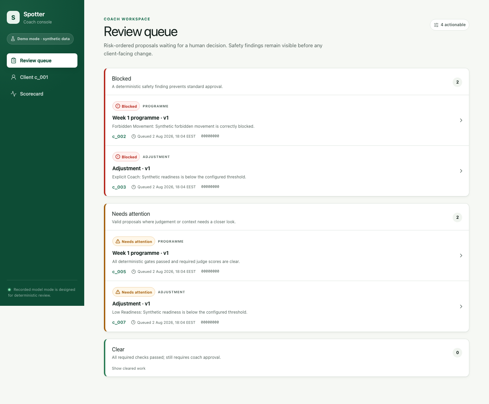
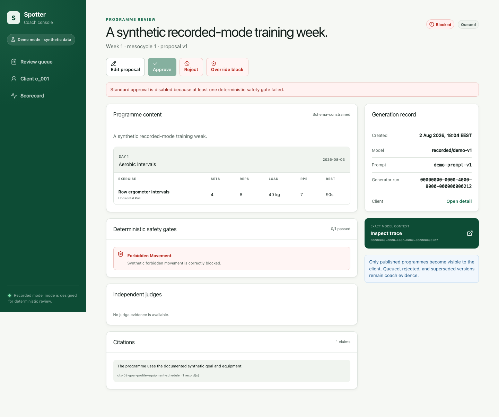
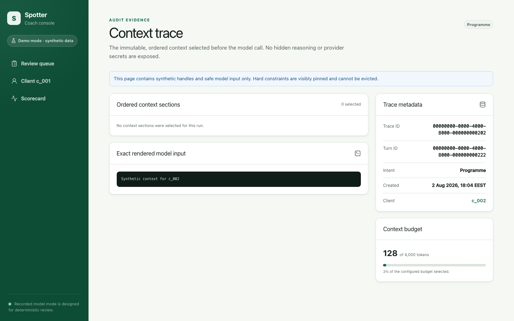
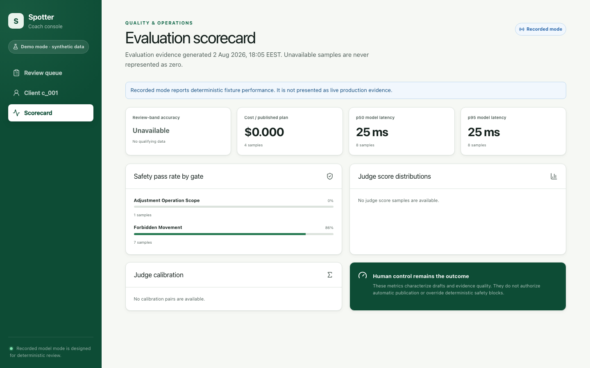
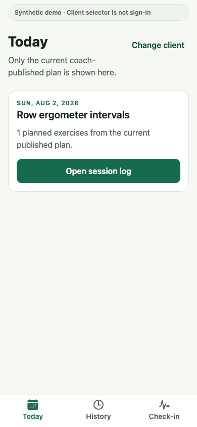

# Spotter

Spotter is a no-auth, synthetic-data V1 of an AI-assisted coaching system. It generates grounded
training programmes, evaluates them with deterministic safety rules and independent quality checks,
routes them through coach approval, and exposes only approved work to the client experience.

The implementation follows the canonical contract in [`DOCS/`](./DOCS/README.md). The repository
contains:

- `frontend/`: Next.js coach console and thin REST adapters.
- `backend/`: server-only domain, application, persistence, agent, evaluation, job, shared-package,
  infrastructure, deterministic-resource, and verification-tooling modules.
- `client-frontend/`: Expo client application.

Backend-owned supporting assets are grouped by responsibility:

- `backend/packages/`: versioned cross-surface contracts, configuration, design tokens, and test
  utilities.
- `backend/resources/`: committed synthetic demo, real-model recordings, pending calibration labels,
  and deterministic safety data.
- `backend/infra/`: PostgreSQL initialization and verification schema declarations.
- `backend/tooling/`: repository verification and operational commands.

Generated reports, coverage, local state, dependencies, and credentials remain untracked. No real
client data or credentials are required for the deterministic V1 path.

For Docker startup, Expo launch, hands-on acceptance, automated E2E commands, and cleanup, follow
the [local and staging playbook](./playbook.md).

## Product screenshots

These are application-build screens rendered with deterministic synthetic fixtures.

### Coach console

| Current build                                                                                                                                       | What it shows                                                         |
| --------------------------------------------------------------------------------------------------------------------------------------------------- | --------------------------------------------------------------------- |
|                          | Populated review queue with risk-ranked items and safety findings.    |
|              | Safety-flagged programme with the deterministic gate finding visible. |
|                       | Exact context trace for the safety-flagged programme.                 |
|  | Evaluation scorecard generated from the seeded recorded-mode runs.    |

See the [coach console gallery](./frontend/README.md) for client context, traceability, and
evaluation evidence.

### Client experience

| Current build                                                                                                                          | What it shows                                                 |
| -------------------------------------------------------------------------------------------------------------------------------------- | ------------------------------------------------------------- |
|          | Today's current coach-published session in the mobile client. |
|  | Readiness and feedback check-in in the mobile client.         |

See the [client experience gallery](./client-frontend/README.md) for client selection and session
logging.
