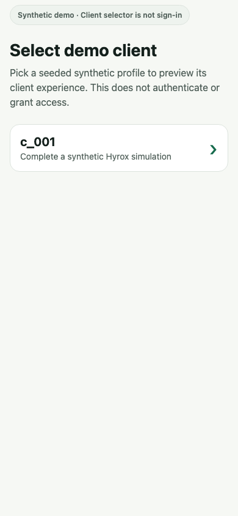
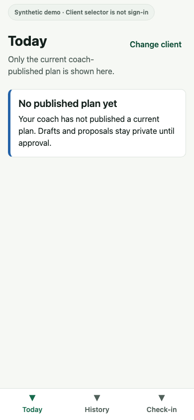
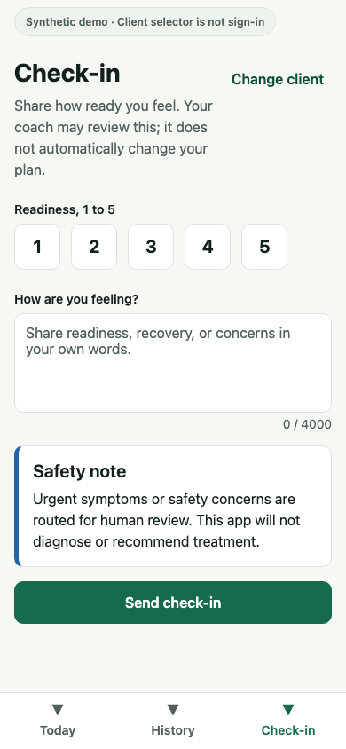
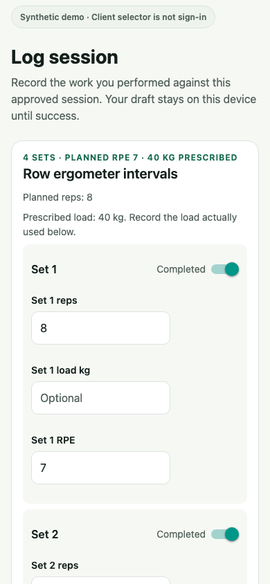

# Client experience

The Expo Router app is Spotter's synthetic, no-auth client surface. The gallery below uses the
production web export at a 390 × 844 mobile viewport with deterministic public-contract fixtures.

## Verified client cases

| Test case                                            | Production screen                                                                                                                                                   |
| ---------------------------------------------------- | ------------------------------------------------------------------------------------------------------------------------------------------------------------------- |
| **QA-CLI-001 — explicit synthetic-client selection** |                         |
| **QA-CLI-003 — unpublished-plan privacy boundary**   |  |
| **QA-CLI-006 — readiness and feedback check-in**     |                             |
| **QA-CLI-004/005 — approved session logging**        |                          |

The client can view approved work, submit readiness and feedback, and log session completion. It
cannot see drafts, proposals, internal evaluations, or coach-only rationale.
