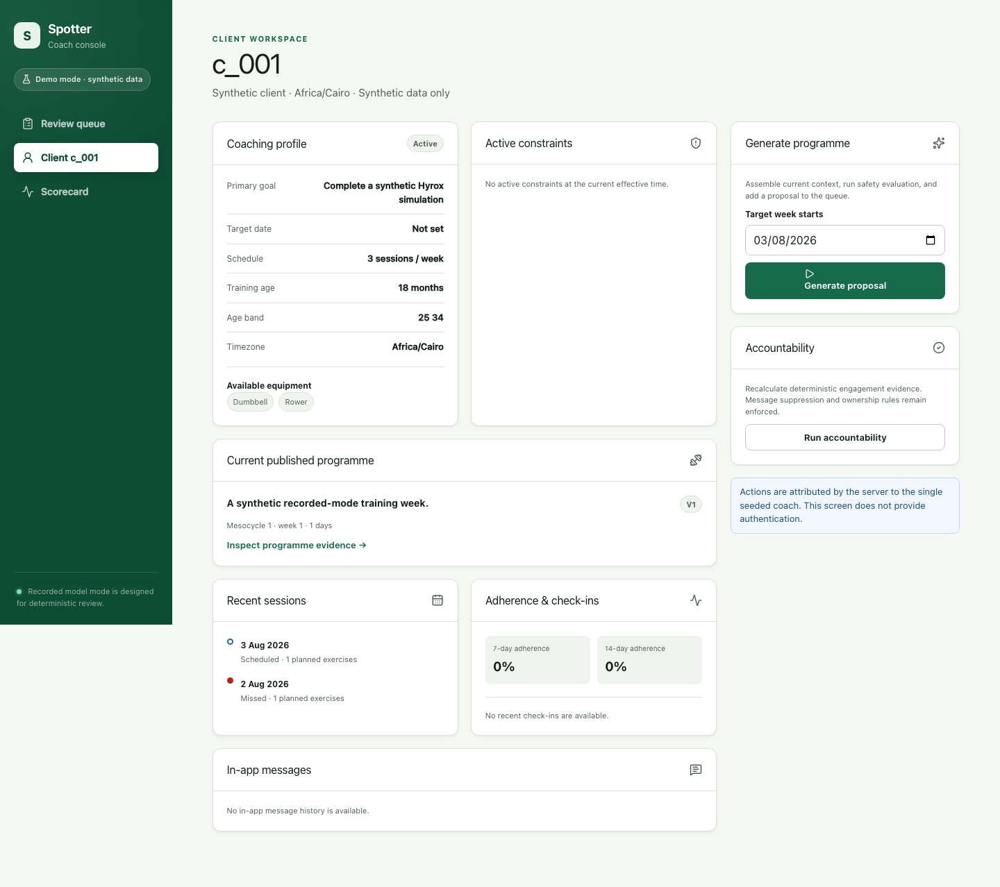

# Coach console

The Next.js coach console is the human review surface for Spotter's deterministic, no-auth V1. These
screenshots were captured by the production Playwright suite at 1440 × 900 using synthetic QA
fixtures.

## Verified coach cases

| Test case                                         | Production screen                                                                                                                                     | What it shows                                                            |
| ------------------------------------------------- | ----------------------------------------------------------------------------------------------------------------------------------------------------- | ------------------------------------------------------------------------ |
| **QA-E2E-001 — deterministic risk ordering**      |              | Populated review queue ordered by blocked, attention, and clear risk.    |
| **QA-E2E-007 — effective client context**         |              | Coach workspace with effective profile, constraints, and evidence links. |
| **QA-E2E-005 — safety-blocked programme review**  |              | Safety-flagged programme with the failing deterministic gate finding.    |
| **QA-E2E-002 — immutable context trace**          |                       | Exact assembled context trace for the safety-flagged programme.          |
| **QA-E2E-010 — independent evaluation scorecard** |  | Recorded-mode scorecard with seeded safety and judge evidence.           |

Only published programmes cross the client visibility boundary; draft and proposed work remain in
the coach workflow.
